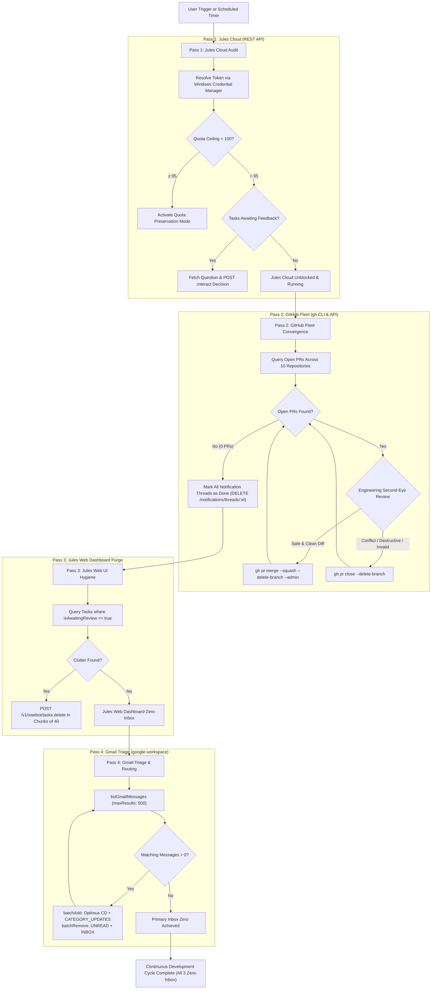
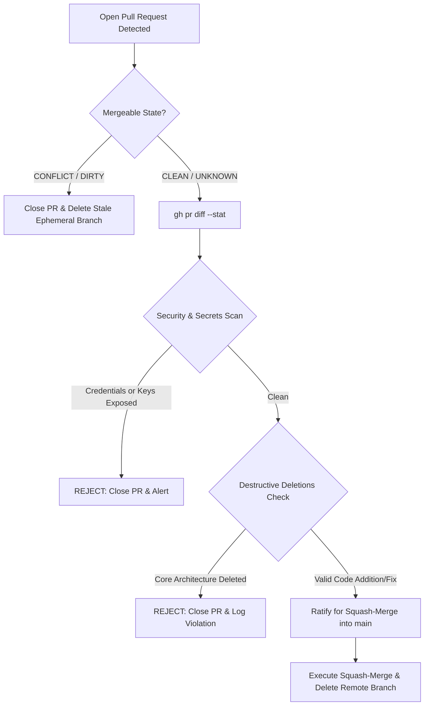
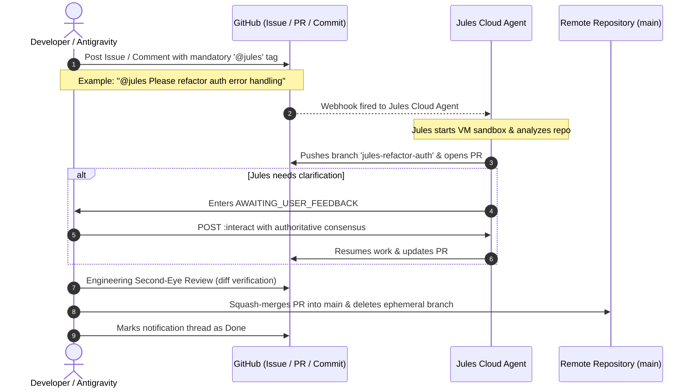
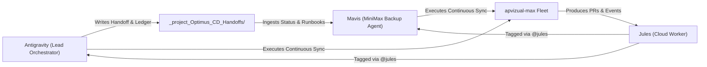

# Workflows & Process Trees: Jules ↔ GitHub ↔ Gmail Continuous Development

**Document Version:** 2.0  
**Location:** `C:\Users\apviz\Documents\Antigravity_Folder\Antigravity_Projects\Antigravity_JULES_INT\docs\WORKFLOWS_AND_PROCESS_TREES.md`  

---

## 1. Tri-Interface Continuous Development Lifecycle

---

## 2. The Verification & Quality Assurance Gate (Engineering Second-Eye Review)

---

## 3. Mandatory `@jules` Trigger & Interaction Flow

---

## 4. Multi-Agent Ecosystem Handoff Tree

