# UNIVERSAL SYSTEM TOPOLOGY & AUTONOMOUS AGENT GUIDELINES (OPTIMUS_PRIME)
> **ULTIMA ACTUALIZARE SOT / LAST UPDATED**: `2026-10-26 22:15:00 UTC+2`  
> **Master SOT Anchor**: `C:\Antigravity - SYSTEM_TOPOLOGY - 3 Partition System\docs\JUNCTIONS_AND_KERNEL_ANCHORS_LEDGER.md`  
> **Target Audience**: All AI Agents (Antigravity, MAVIS / MiniMax, Claude Code, Qwen Code, Hermes, Agent Zero, Jules, etc.)  
> **Current Status**: Final 3-Drive Architecture (`C: 290.40 GB Free`, `D: 170.06 GB Free`, `E: 180.13 GB Free`, `G: Google Drive mirrored on E:`)  
> **Language**: English & Romanian (System Dual-Alignment)

---

## 1. CRITICAL ARCHITECTURAL INVARIANT: THREE-DRIVE PARTITIONING MODEL

This workstation (`OPTIMUS_PRIME`, Windows 11 Pro, 64 GB Physical RAM, 32 vCPUs) follows a strict **Three-Drive Division of Labor**:

```mermaid
flowchart TD
    subgraph DriveC["C: System Drive (Capacity: 476 GB, Free: ~290.4 GB / ~61% Free)"]
        OS["Windows 11 OS & System Binaries"]
        Agents["Agent Binaries & Active Runtimes (Antigravity, Hermes, MiniMax, Qwen, Jules)"]
        Junctions["Transparent Directory Junctions (mklink /J)"]
    end

    subgraph DriveD["D: Archive, Docker & Virtual Memory (Capacity: 465 GB, Free: ~170.1 GB)"]
        Backups["D:\Backups_Archive (Backup & Archive Physical Source)"]
        HermesArchive["D:\HERMES_BACKUP_ARCHIVE (Hermes Physical Source)"]
        Docker["D:\Docker\wsl (docker_data.vhdx 69.9 GB, 65 Containers)"]
        GoogleModels["D:\Google (Chrome On-Device AI Models 8.1 GB, Google Windows App)"]
        AI_Models["D:\AI_Models (Ollama Models & Heavy Weights)"]
        Swap["D:\pagefile.sys (8-16 GB) & D:\wsl_swap.vhdx (8 GB)"]
    end

    subgraph DriveE["E: AI Drive - Active Workspace & Google Cloud PKMS (Capacity: 465 GB, Free: ~180.1 GB)"]
        Vault["E:\MINTE (Obsidian Knowledge Vault & Central Second Brain)"]
        GDriveMirror["E:\Google (Active Google Drive Cache, GDrive Junction & GitData)"]
        PKMS_SOT["E:\Google\GDrive\GDrive-Second_Brain_PKMS\02_Areas\02-2-AI-SOT (Master AI SOT)"]
        CASA_Home["E:\Google\GDrive\...\02-2-AI-SOT\CASA (Physical Source)"]
        AITools_Home["E:\Google\GDrive\...\CASA\OPTIMUS - Prime\AI_Tools (Physical Source)"]
        OptimusCD_Home["E:\Google\GDrive\...\CASA\OPTIMUS - Prime\Optimus_CD (by Jules) (Physical Source)"]
        OptimusCI_Home["E:\Google\GDrive\...\CASA\OPTIMUS - Prime\Optimus_CI (by Mavis) (Physical Source)"]
        Switched_Sources["SYS_REPORTS, SESSION_ARCHIVES, SAVE-RESTORE_POINT, Antigravity_JULES_INT (Physical Sources)"]
        Directional_Docs["Directional Documentation Points (.md pointing to D: Backups)"]
    end

    subgraph DriveG["G: Google Drive for Desktop Virtual Mount"]
        GDrive["Virtual Volume Mount (Mirrored on E:\Google\GDrive, Cache on E:\Google\Cache)"]
    end

    Junctions -->|Transparent Redirect| Backups
    Junctions -->|Transparent Redirect| HermesArchive
    Junctions -->|Transparent Redirect| GoogleModels
    Junctions -->|Transparent Redirect| AI_Models
    Junctions -->|Transparent Redirect| CASA_Home
    Junctions -->|Transparent Redirect| AITools_Home
    Junctions -->|Transparent Redirect| OptimusCD_Home
    Junctions -->|Transparent Redirect| OptimusCI_Home
    Junctions -->|Transparent Redirect| Switched_Sources
    Directional_Docs -. "Instrucțiuni Direcționale" .-> Backups
    GDrive -->|Kernel Bridge| GDriveMirror
```

---

## 2. MASTER GROUND TRUTH SOURCES & DEPENDENCY MAPPING (TABELUL SURSELOR FIZICE)

Pentru a asigura integritatea absolută a sistemului în orice scenariu (indiferent de starea pictogramelor sau a cache-ului Explorer), mai jos este specificată **SURSA FIZICĂ AUTENTICĂ (Ground Truth Physical Source)** pentru fiecare componentă a arhitecturii:

| Componentă / Namespace | Cale Acces / Joncțiune (Reparse Point) | Sursa Fizică Reală (Unde trăiesc octeții pe disc) | Partiție Fizică | Sincronizare Cloud & Observații |
| :--- | :--- | :--- | :---: | :--- |
| **`AI_Tools` Suite** | `C:\Users\apviz\AI_Tools` | `E:\Google\GDrive\GDrive-Second_Brain_PKMS\02_Areas\02-2-AI-SOT\CASA\OPTIMUS - Prime\AI_Tools` | **`E:`** | **Sincronizat Cloud (Google Drive)**. 63.758 fișiere native (Agent Zero, AionUi, Qwen System, Antigravity Terminal). |
| **`CASA` Workspace** | `C:\Users\apviz\AppData\Local\hermes\HERMES_OPTIMUS\CASA` | `E:\Google\GDrive\GDrive-Second_Brain_PKMS\02_Areas\02-2-AI-SOT\CASA` | **`E:`** | **Sincronizat Cloud (Google Drive)**. Spațiul canonic de lucru Hermes & AI SOT. |
| **`Optimus_CD (Jules)`**| `C:\Users\apviz\.minimax-agent\projects\Optimus_CD (by Jules)` | `E:\Google\GDrive\GDrive-Second_Brain_PKMS\02_Areas\02-2-AI-SOT\CASA\OPTIMUS - Prime\Optimus_CD (by Jules)` | **`E:`** | **Sincronizat Cloud (Google Drive)**. Consolidat în OPTIMUS - Prime. |
| **`Optimus_CI (Mavis)`**| `C:\Users\apviz\.minimax-agent\projects\Optimus_CI (by Mavis)` | `E:\Google\GDrive\GDrive-Second_Brain_PKMS\02_Areas\02-2-AI-SOT\CASA\OPTIMUS - Prime\Optimus_CI (by Mavis)` | **`E:`** | **Sincronizat Cloud (Google Drive)**. Consolidat în OPTIMUS - Prime. |
| **`Antigravity_JULES_INT`**| `C:\Users\apviz\Documents\Antigravity_Folder\Antigravity_Projects\Antigravity_JULES_INT` | `E:\Google\GDrive\GDrive-Second_Brain_PKMS\02_Areas\02-2-AI-SOT\CASA\OPTIMUS - Prime\Optimus_CD (by Jules)\Antigravity_JULES_INT` | **`E:`** | **Sincronizat Cloud (Google Drive)**. Relocat pe E:, joncțiune inversă activă pe C:. |
| **`SYS_REPORTS`** | `C:\Users\apviz\AppData\Local\hermes\SYS_REPORTS` | `E:\Google\GDrive\GDrive-Second_Brain_PKMS\02_Areas\02-2-AI-SOT\CASA\OPTIMUS - Prime\SYS_REPORTS` | **`E:`** | **Sincronizat Cloud (Google Drive)**. SWITCH executat. Rapoarte active Hermes. |
| **`SESSION_ARCHIVES`** | `C:\Users\apviz\AppData\Local\hermes\SESSION_ARCHIVES` | `E:\Google\GDrive\GDrive-Second_Brain_PKMS\02_Areas\02-2-AI-SOT\CASA\OPTIMUS - Prime\SESSION_ARCHIVES` | **`E:`** | **Sincronizat Cloud (Google Drive)**. SWITCH executat. 1.391 sesiuni Hermes. |
| **`SAVE-RESTORE_POINT`** | `D:\HERMES_BACKUP_ARCHIVE\SAVE-RESTORE_POINT` & `C:\Users\apviz\HERMES_BACKUP\SAVE-RESTORE_POINT` | `E:\Google\GDrive\GDrive-Second_Brain_PKMS\02_Areas\02-2-AI-SOT\CASA\OPTIMUS - Prime\SAVE-RESTORE_POINT` | **`E:`** | **Sincronizat Cloud (Google Drive)**. SWITCH executat. Puncte de restaurare. |
| **`HERMES_BACKUP` (Master)** | `C:\Users\apviz\HERMES_BACKUP` | `D:\HERMES_BACKUP_ARCHIVE` | **`D:`** | **Arhivă Locală D:**. Sursa fizică pentru toate snapshot-urile Hermes. |
| **`HERMES_BACKUP` (Local)** | `C:\Users\apviz\AppData\Local\hermes\HERMES_BACKUP` | `D:\HERMES_BACKUP_ARCHIVE` *(via C:\Users\apviz\HERMES_BACKUP)* | **`D:`** | **Arhivă Locală D:**. |
| **`DOCKER_BACKUP`** | `C:\Users\apviz\DOCKER_BACKUP` | `D:\Backups_Archive\DOCKER_BACKUP` | **`D:`** | **Arhivă Locală D:**. |
| **`QWEN_BACKUP`** | `C:\Users\apviz\QWEN_BACKUP` | `D:\Backups_Archive\QWEN_BACKUP` | **`D:`** | **Arhivă Locală D:**. |
| **`QWEN_MIRROR`** | `C:\Users\apviz\QWEN_MIRROR` | `D:\Backups_Archive\QWEN_MIRROR` | **`D:`** | **Arhivă Locală D:**. |
| **`MINIMAX_BACKUP`** | `C:\Users\apviz\MINIMAX_BACKUP` | `D:\Backups_Archive\MINIMAX_BACKUP` | **`D:`** | **Arhivă Locală D:**. |
| **`GitHub - Download`**| `C:\Users\apviz\Documents\GitHub - Download` | `D:\GitHub_Archives` | **`D:`** | **Arhivă Locală D:**. |
| **`Ollama Models`** | `C:\Users\apviz\.ollama\models` | `D:\AI_Models\ollama\models` | **`D:`** | **Stocare Grele Modele AI pe D:**. |
| **`Ollama Backup`** | `C:\Users\apviz\.ollama\backup` | `D:\Backups_Archive\dot_ollama_backup` | **`D:`** | **Arhivă Locală D:**. |
| **`Claude Backups`** | `C:\Users\apviz\.claude\backups` | `D:\Backups_Archive\dot_claude_backups` | **`D:`** | **Arhivă Locală D:**. |
| **`Hermes Backups`** | `C:\Users\apviz\.hermes\backups` | `D:\Backups_Archive\dot_hermes_backups` | **`D:`** | **Arhivă Locală D:**. |
| **`Hermes Trash`** | `C:\Users\apviz\.hermes-trash` | `D:\Backups_Archive\dot_hermes_trash` | **`D:`** | **Arhivă Locală D:**. |
| **`Minimax Debugger`**| `C:\Users\apviz\Minimax Debugger\backup` | `D:\Backups_Archive\Minimax_Debugger_backup` | **`D:`** | **Arhivă Locală D:**. |
| **`Antigravity IDE`** | `C:\Users\apviz\AppData\Roaming\Antigravity IDE\Backups` | `D:\Backups_Archive\Antigravity_IDE_Roaming_Backups` | **`D:`** | **Arhivă Locală D:**. |
| **Minimax Agent (11 Backups)** | `C:\Users\apviz\.minimax-agent\projects\FULL_BACKUP_*` | `D:\Backups_Archive\minimax_projects_backups\FULL_BACKUP_*` | **`D:`** | **Arhivă Locală D:**. 11 foldere istorice de backup. |
| **Chrome AI Models (Nano, etc.)** | `C:\Users\apviz\AppData\Local\Google\Chrome*\User Data\*` | `D:\Google\*` | **`D:`** | **Stocare Modele On-Device pe D:** (Gemini Nano weights, SODALanguagePacks, TranslateKit). |
| **Google Windows App** | `C:\Users\apviz\AppData\Local\Google\Google` | `D:\Google\Google_Windows_App` | **`D:`** | **Stocare D:**. Scut SQLite `BEFORE INSERT/UPDATE RAISE(IGNORE)` activ. |
| **Docker WSL2 VHDX** | N/A (Kernel Anchor) | `D:\Docker\wsl\disk\docker_data.vhdx` | **`D:`** | **Kernel Anchor (69.9 GB)**. Interzis mklink. |
| **Google Drive Cache** | N/A (Kernel Anchor) | `E:\Google\Cache\100488352004104984848\content_cache` | **`E:`** | **Kernel Anchor (~17-50 GB)**. Interzis mklink. |
| **Windows Pagefile** | N/A (Kernel Anchor) | `D:\pagefile.sys` (8192-16384 MB) | **`D:`** | **Kernel Anchor Memory**. Interzis mklink. |

---

## 3. PROTOCOLUL DE DOCUMENTARE DIRECȚIONALĂ (DIRECTIONAL DOCUMENTING)

Pentru spațiile administrate de Google Drive for Desktop (`E:\Google\GDrive\...`), joncțiunile NTFS cross-volume (`E:` ➔ `D:`) provoacă erori Win32 `PERMISSION_DENIED` și blochează sincronizarea cloud în bucle infinite. În situațiile în care sursele fizice sunt **arhive de backup** ce trebuie să rămână pe partiția **D:** (pentru a respecta topologia de stocare la rece și a nu polua partiția cloud E:), este interzisă operațiunea SWITCH.

**Soluția Canonică**: Înlocuirea fiecărei joncțiuni cross-volume problematice cu un document direcțional `.md` omonim:

| Document Direcțional (.md) | Conținut / Directivă de Navigare | Ținta Fizică Locală |
| :--- | :--- | :--- |
| `.../AI_Tools/qwen-system/backups.md` | `To see this folder please access this path: D:\Backups_Archive\qwen_system_backups` | `D:\Backups_Archive\qwen_system_backups` |
| `.../AI_Tools/Antigravity_Ecosystem_Terminal/quarantine_backup_20261003_031324.md` | `To see this folder please access this path: D:\Backups_Archive\Antigravity_Ecosystem_Terminal_quarantine_backup_20261003_031324` | `D:\Backups_Archive\Antigravity_Ecosystem_Terminal_quarantine_backup_20261003_031324` |
| `.../AI_Tools/qwen-system/savepoints.md` | `To see this folder please access this path: D:\Backups_Archive\qwen_system_savepoints` | `D:\Backups_Archive\qwen_system_savepoints` |
| `.../AI_Tools/qwen-system/backups_loop_trash.md` | `To see this folder please access this path: D:\Backups_Archive\qwen_system_backups_loop_trash` | `D:\Backups_Archive\qwen_system_backups_loop_trash` |

> [!NOTE]
> **Regulă de Utilizare**: În mod implicit, sistemul utilizează întotdeauna joncțiuni NTFS normale (`mklink /J`). Punctele de Documentare Direcțională sunt create **doar la cererea expresă a utilizatorului** sau în arborele de sincronizare Google Drive unde este strict necesară menținerea arhivelor pe partiția D:.

---

## 4. CELE 3 ANCORE CRITICE LA NIVEL DE KERNEL (INTERZIS MKLINK)

1. **Docker WSL2 VHDX (`69.90 GB`, 65 Containere)**:
   * **Sursă Fizică**: `D:\Docker\wsl\disk\docker_data.vhdx` și `D:\Docker\wsl\main\ext4.vhdx`.
   * **De ce nu mklink**: Driverul Hyper-V `vhdmp.sys` eșuează pe reparse points cross-volume.
   * **Ancorare Oficială**: `HKCU:\Software\Microsoft\Windows\CurrentVersion\Lxss` (`BasePath = \\?\D:\Docker\wsl\main`) și `C:\Users\apviz\AppData\Roaming\Docker\settings-store.json`.
2. **Cache Conținut Google Drive for Desktop (`E:\Google\Cache` — ~17–50 GB)**:
   * **Sursă Fizică**: `E:\Google\Cache\100488352004104984848\content_cache`.
   * **De ce nu mklink**: Driverul de filtrare `drivefsp.sys` se leagă direct de GUID-ul fizic al volumului.
   * **Ancorare Oficială**: Setare nativă în preferințele Google Drive, consemnată în `C:\Users\apviz\AppData\Local\Google\DriveFS\100488352004104984848\content_cache_path`.
3. **Memoria Virtuală Windows (`pagefile.sys`)**:
   * **Sursă Fizică**: `D:\pagefile.sys` (`InitialSize: 8192 MB`, `MaximumSize: 16384 MB`).
   * **De ce nu mklink**: Deschis în Faza 0 de boot de microkernel-ul `ntoskrnl.exe` înainte de încărcarea NTFS reparse driver.
   * **Ancorare Oficială**: `HKLM:\SYSTEM\CurrentControlSet\Control\Session Manager\Memory Management\PagingFiles` = `D:\pagefile.sys 8192 16384`.

---

## 5. REGULI STRICTE ȘI OBLIGATORII PENTRU TOȚI AGENȚII AUTONOMI

1. **SPAȚIUL ACTIV DE DEZVOLTARE ESTE PE `E:`**:
   - Toate notele Obsidian, repository-urile noi și proiectele în lucru aparțin exclusiv de `E:\MINTE` sau `E:\Google\GDrive\GDrive-Second_Brain_PKMS\`.
2. **INTERZISĂ CREAREA DE BACKUP-URI LOCALE PE `C:`**:
   - Orice backup se scrie exclusiv în `D:\Backups_Archive\<ToolName>\` sau prin joncțiunile transparente existente. Nu creați niciodată foldere noi `backup` sau `full_backup` pe `C:\Users\apviz\`.
3. **FOLOSIȚI ÎNTOTDEAUNA `robocopy /E /XJ` PENTRU COPIERI/MUTĂRI**:
   - Comenzile recursive oarbe (ex. `Copy-Item -Recurse`) parcurg joncțiunile creând bucle infinite exponențiale ($2^N$). Folosiți mereu `/XJ` (exclude junctions).
4. **FĂRĂ UTF-8 BOM ÎN FIȘIERELE DE CONFIGURARE ȘI SKILL-URI**:
   - Salvați întotdeauna în Pure UTF-8 fără BOM (`0xEF 0xBB 0xBF`), pentru a nu corupe parserele Go, YAML, JSON sau Protobuf.
5. **MANDATORY SOT TOPOLOGY DOCUMENTATION ÎN FIECARE RĂDĂCINĂ CU JONCȚIUNI**:
   - Oriunde există cel puțin o joncțiune într-un folder rădăcină, acest fișier (`README_SYSTEM_TOPOLOGY_AND_AGENT_GUIDELINES.md`) trebuie să fie prezent, identic și actualizat la zi.

---
*Generated & Sealed: 2026-10-26 22:15:00 UTC+2 | Antigravity Sentinel Systems Terminal • Station OPTIMUS PRIME*
