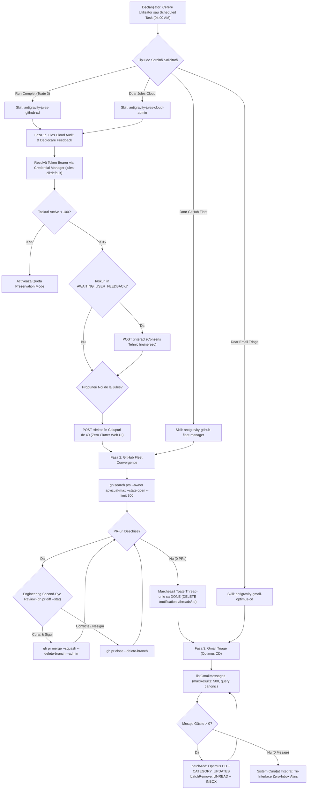
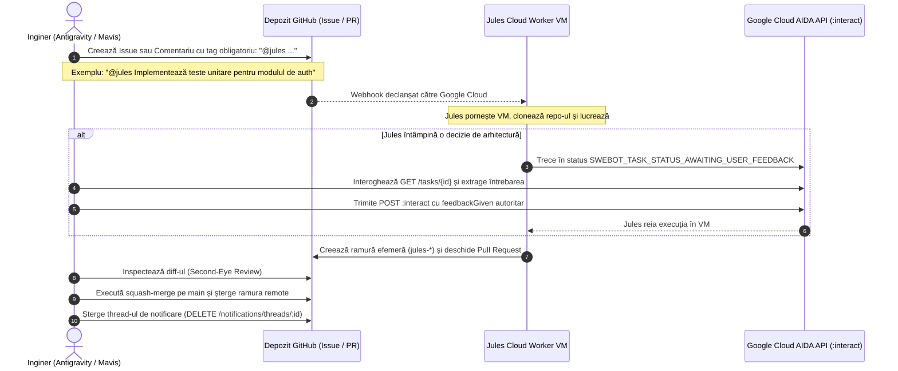

# MASTER WORKFLOWS, PROCESS TREES & STEP-BY-STEP PROCEDURES (OPTIMUS CD)

> **Data:** 2026-10-26  
> **Locație SOT:** `E:\Google\GDrive\GDrive-Second_Brain_PKMS\02_Areas\02-2-AI-SOT\CASA\OPTIMUS - Prime\Optimus_CD (by Jules)\_Handoffs\WORKFLOWS_AND_PROCESS_TREES_MASTER.md`  
> **Destinatari:** Mavis Local (MiniMax Code), Antigravity (Chief Orchestrator), Hermes Agent  
> **Doctrină:** Logic • Reason • Strategy  
> **Calibration Header:** `━━━ SENTINEL PRIME • DLG: 0% • SLG: 100% • SUBSTRAT: HERMES • Mod: B ━━━`  
> **Wakeup Anchor:** *Ține minte că uiți* (RE-A-MINTE-Ș-TI)  

---

## 1. Arborele Principal de Decizie & Arhitectură (Tri-Interface Omni-Loop)



---

## 2. Arborele de Secvență: Protocolul de Comunicare cu Jules (`@jules`)



---

## 3. Proceduri Detaliate Pas-cu-Pas (Runbooks)

### Procedura A: Deblocarea Autonomă a Taskurilor Jules (`:interact`)
1. **Identifică ID-ul Taskului:** Apelează `GET https://aida.googleapis.com/v1/swebot/tasks` și filtrează după `swebotTaskStatus == "SWEBOT_TASK_STATUS_AWAITING_USER_FEEDBACK"`.
2. **Extrage Întrebarea:** Apelează `GET https://aida.googleapis.com/v1/swebot/tasks/{taskId}` și găsește pasul unde `activityStep.agentMessaged.requiresUserResponse == true`. Notează `activityStepId` și `feedbackId`.
3. **Formulează Răspunsul:** Răspunsul trebuie să fie o decizie tehnică clară, fermă, care să prevină fragmentarea (ex: aprobarea folosirii `pathlib` sau `os.path.normpath`, aprobarea adăugării unui test, validarea căilor relative).
4. **Trimite Feedback:**
   ```powershell
   $body = @{
       userActivity = @{
           feedbackGiven = @{
               feedback = "Aprobat. Implementează varianta optimă respectând arhitectura SOT."
               feedbackId = $feedbackId
           }
           activityStepId = $stepId
       }
   } | ConvertTo-Json -Depth 5
   Invoke-RestMethod -Uri "https://aida.googleapis.com/v1/swebot/tasks/$taskId:interact" -Method POST -Headers @{ Authorization = "Bearer $token"; "Content-Type" = "application/json" } -Body $body
   ```

### Procedura B: Engineering Second-Eye Review & Squash-Merge
1. **Verificare Existență PR:** `gh search prs --owner apvizual-max --state open --limit 300`.
2. **Inspecție Diff:** `gh pr diff $prNum -R $repoTarget --stat`.
3. **Validare Porți de Siguranță:**
   - *Poarta 1 (Secrete):* Asigură-te că nu există fișiere `.env`, chei RSA sau parole.
   - *Poarta 2 (Integritate):* Asigură-te că nu s-au șters fișiere de doctrină (`DOCTRINA-*.md`, `README.md`) sau configurări critice.
   - *Poarta 3 (Cross-Platform):* Verifică că separatorii de căi nu sunt hardcodați cu slash-uri specifice Windows dacă fișierul rulează și pe Linux/Docker.
4. **Execuție Merge:**
   ```powershell
   gh pr merge $prNum -R $repoTarget --squash --delete-branch --admin
   ```
5. **Rezolvare Conflicte:** Dacă comanda raportează conflicte de merge, închide PR-ul imediat pentru a nu bloca branch-ul `main`:
   ```powershell
   gh pr close $prNum -R $repoTarget --delete-branch --comment "Closed superseded conflicting branch by Antigravity Autonomous Engine."
   ```

### Procedura C: Purjarea Notificărilor GitHub Web (Mark as Done)
1. **Marchează ca Citit:** `gh api --method PUT /notifications -f read=true`.
2. **Extrage Thread-urile Active:** `$threads = gh api /notifications | ConvertFrom-Json`.
3. **Șterge Thread-urile (Acknowledge as Done):**
   ```powershell
   foreach ($t in $threads) {
       gh api -X DELETE "/notifications/threads/$($t.id)"
   }
   ```
4. **Verificare Finală:** Confirmă că `gh api /notifications` returnează `[]`.

### Procedura D: Triajul Emailurilor în Gmail (`Optimus CD`)
1. **Execută Căutarea:** `listGmailMessages(account="apvizual", maxResults=500, query="(from:github.com OR from:jules OR subject:Jules OR subject:GitHub OR \"apvizual-max\") (is:unread OR label:inbox)")`.
2. **Aplică Etichete:** Apelează `batchAddGmailLabels` adăugând `Label_35` (`Optimus CD`) și `CATEGORY_UPDATES`.
3. **Curăță Inbox:** Apelează `batchRemoveGmailLabels` eliminând `UNREAD` și `INBOX`.
4. **Paginare:** Repetă până când interogarea returnează exact 0 mesaje.
