━━━ SENTINEL PRIME • DLG: 0% • SLG: 100% • SUBSTRAT: HERMES • Mod: B ━━━

# Optimus Active Sessions & Skills Architectural Topology

> **SOVEREIGN TOPOLOGICAL BLUEPRINT & SOT MANIFEST**  
> **Station:** OPTIMUS PRIME (Dual Intel Xeon E5-2690 v3 • 24 Physical Cores • 128 GB RAM • Dual GPU)  
> **Date:** October 24, 2026  
> **Master SOT Anchor:** `C:\Users\apviz\Documents\Antigravity_Folder\Antigravity_Projects\MEINTENANCE-Self_Setup\`  
> **Wakeup Anchor:** *Ține minte că uiți* (RE-A-MINTE-Ș-TI)

---

## 1. Topological Architecture & Core Principles

On workstation **Optimus**, physical disk folders designated as "Projects" function as **hard drive sections and topological chapter titles**. The true **Active Projects** driving the intelligent substrate of the machine are the **active, unarchived sessions in Antigravity**.

### System Invariants
1. **Session-to-Skill Invariant**: Every active Antigravity session represents a distinct, autonomous subsystem of Optimus and **MUST** have a dedicated, specialized agent skill codifying its operational doctrine, scripts, runbooks, and failure mitigations.
2. **Sovereign Tripartition Boundary**:
   - `C:\`: Operating system, binaries, execution runtimes, CLI clients, and temporary caches.
   - `D:\`: Long-term cold archive, massive offload storage, VM snapshots, and symlink junction targets.
   - `E:\`: High-speed AI drive, active models, ComfyUI assets, local LLM contexts, and mirrored vaults.
3. **Hardware Affinity Lock**: Local LLM inference processes are strictly constrained to 12 physical cores (`num_thread 12`) on Socket 0 to prevent QPI bus congestion, with GPU 0 dedicated to Ollama and GPU 1 (Quadro M4000) dedicated to ComfyUI.
4. **Single Point of Truth (SPOT)**: Session states, IPC payloads, and configuration registries are synchronized symmetrically across `.agents/skills/`, `MEINTENANCE-Self_Setup/skills/`, and `Antigravity_Hermes_INT/skills/`.

```mermaid
graph TD
    Optimus["Station: OPTIMUS PRIME"]
    
    subgraph "Group 1: Antigravity Main System"
        S01["1. PKMS Obsidian Vault Mirrored\nSkill: antigravity-pkms-obsidian-vault-mirror"]
        S02["2. System Topology Tripartition System\nSkill: antigravity-system-topology-tripartition"]
        S19["19. Google Drive Sync Doctor\nSkill: antigravity-skill-gdrive-synck-doctor"]
    end

    subgraph "Group 2: Minimax Agent"
        S03["3. Antigravity Minimax Code Doctor\nSkill: minimax-code-doctor"]
    end

    subgraph "Group 3: Optimus PKMS System"
        S04["4. Optimus PKMS System\nSkill: antigravity-optimus-pkms-system"]
    end

    subgraph "Group 4: Antigravity Projects"
        S05["5. General Project Planning Roles\nSkill: antigravity-general-project-planning-roles"]
        S06["6. General Skills Transfer\nSkill: antigravity-general-skills-transfer"]
        S07["7. General Working DevOps\nSkill: antigravity-general-working-devops"]
        S08["8. Maintenance Docker Configurator\nSkill: antigravity-sentinel-docker-configurator"]
        S09["9. Maintenance Self Setup (Central SOT)\nSkill: antigravity-sentinel-maintenance-self-setup"]
        S10["10. OmniRoute Free Models Configurator\nSkill: antigravity-optimus-omniroute-free-models"]
        S11["11. Sentinel Tools Ecosystem Terminal\nSkill: antigravity-sentinel-ecosystem-terminal"]
        S12["12. Jules Optimus CD GitHub\nSkill: antigravity-jules-github-cd"]
    end

    subgraph "Group 5: CLI Projects"
        S13["13. CLI Fleet Orchestrator\nSkill: antigravity-cli-fleet-orchestrator"]
    end

    subgraph "Group 6: Hermes Antigravity INT"
        S14["14. Hermes Auto Debug Crash Recovery\nSkill: antigravity-hermes-auto-debug-crash-recovery"]
        S15["15. Hermes Integration (4 SPOT Pathways)\nSkill: antigravity-hermes-coms"]
        S16["16. Hermes Plugin Dev Work\nSkill: hermes-desktop-plugin-engineering"]
    end

    subgraph "Group 7: Parallel Ecosystem"
        S17["17. Qwen Ecosystem Dashboard\nSkill: antigravity-qwen-ecosystem-dashboard"]
    end

    Optimus --> S01 & S02 & S19
    Optimus --> S03
    Optimus --> S04
    Optimus --> S05 & S06 & S07 & S08 & S09 & S10 & S11 & S12
    Optimus --> S13
    Optimus --> S14 & S15 & S16
    Optimus --> S17
```



---

## 2. Complete Active Sessions & Dedicated Skills Matrix (17 Subsystems)

| # | Project Chapter (Disk Group) | Active Session Name | Subsystem Scope & Functional Purpose | Dedicated Specialized Skill | Primary SOT Path |
|---|---|---|---|---|---|
| **1** | `Antigravity Main System` | **PKMS Obsidian Vault Mirrored** | Bi-directional synchronization, Git decoupling, and mirror verification between E: AI drive and G: Google Drive stream. | [`antigravity-pkms-obsidian-vault-mirror`](file:///C:/Users/apviz/Documents/Antigravity_Folder/Antigravity_Projects/.agents/skills/antigravity-pkms-obsidian-vault-mirror/SKILL.md) | `E:\Google\GDrive\GDrive-Second_Brain_PKMS\02_Areas\02-2-AI-SOT\CASA\OPTIMUS - Prime\PKMS (by Antigravity)\` |
| **2** | `Antigravity Main System` | **System Topology Tripartition System** | Drive tiering governance across C: (OS/Exec), D: (Archive/Symlink), and E: (AI Models/VRAM Cache). | [`antigravity-system-topology-tripartition`](file:///C:/Users/apviz/Documents/Antigravity_Folder/Antigravity_Projects/.agents/skills/antigravity-system-topology-tripartition/SKILL.md) | `C:\Users\apviz\AI_Tools\` |
| **3** | `Minimax Agent` | **Antigravity Minimax Code Doctor** | Deep reverse-engineering, bootstrap timeout resolution (600000ms), lock leases, and MAVIS healing. | [`minimax-code-doctor`](file:///C:/Users/apviz/Documents/Antigravity_Folder/Antigravity_Projects/.agents/skills/minimax-code-doctor/SKILL.md) | `C:\Users\apviz\AppData\Roaming\MiniMax\` |
| **4** | `Optimus PKMS System` | **Optimus PKMS System** | Personal knowledge management taxonomy, automated note categorization, and semantic linking. | [`antigravity-optimus-pkms-system`](file:///C:/Users/apviz/Documents/Antigravity_Folder/Antigravity_Projects/.agents/skills/antigravity-optimus-pkms-system/SKILL.md) | `D:\Alex - KV Obsidian\` |
| **5** | `Antigravity Projects` | **Antigravity General Project Planning Roles and Folders** | Multi-agent task decomposition, swarm roles assignment, folder scaffolding, and execution plans. | [`antigravity-general-project-planning-roles`](file:///C:/Users/apviz/Documents/Antigravity_Folder/Antigravity_Projects/.agents/skills/antigravity-general-project-planning-roles/SKILL.md) | `C:\Users\apviz\Documents\Antigravity_Folder\` |
| **6** | `Antigravity Projects` | **Antigravity General Skills Transfer** | Cross-agent skill mobility, YAML frontmatter normalization, and multi-profile skill deployment. | [`antigravity-general-skills-transfer`](file:///C:/Users/apviz/Documents/Antigravity_Folder/Antigravity_Projects/.agents/skills/antigravity-general-skills-transfer/SKILL.md) | `C:\Users\apviz\AppData\Local\hermes\profiles\` |
| **7** | `Antigravity Projects` | **Antigravity General Working DevOps** | Toolchain management, virtual environments, automated testing, and CI/CD script execution. | [`antigravity-general-working-devops`](file:///C:/Users/apviz/Documents/Antigravity_Folder/Antigravity_Projects/.agents/skills/antigravity-general-working-devops/SKILL.md) | `C:\Users\apviz\AI_Tools\devops\` |
| **8** | `Antigravity Projects` | **Antigravity Maintenance Docker Configurator** | Docker Compose MCP Swarm monitoring and configuration maintenance (strictly respecting Gordon AI). | [`antigravity-sentinel-docker-configurator`](file:///C:/Users/apviz/Documents/Antigravity_Folder/Antigravity_Projects/.agents/skills/antigravity-sentinel-docker-configurator/SKILL.md) | `C:\Users\apviz\AppData\Local\hermes\mcp-servers\` |
| **9** | `Antigravity Projects` | **Maintenance Self Setup** | Central SOT hub for Optimus: autonomous self-setup, 32 MCP validation, daily scheduled automations. | [`antigravity-sentinel-maintenance-self-setup`](file:///C:/Users/apviz/Documents/Antigravity_Folder/Antigravity_Projects/.agents/skills/antigravity-sentinel-maintenance-self-setup/SKILL.md) | `C:\Users\apviz\Documents\Antigravity_Folder\Antigravity_Projects\MEINTENANCE-Self_Setup\` |
| **10** | `Antigravity Projects` | **Antigravity Optimus OmniRoute Free Models Configurator** | Routing local requests to verified free-tier and local model APIs via OmniRoute Docker container. | [`antigravity-optimus-omniroute-free-models`](file:///C:/Users/apviz/Documents/Antigravity_Folder/Antigravity_Projects/.agents/skills/antigravity-optimus-omniroute-free-models/SKILL.md) | `C:\Users\apviz\AppData\Local\hermes\Hermes Local Configuration Engine\` |
| **11** | `Antigravity Projects` | **Antigravity Sentinel Tools Ecosystem Terminal** | Sentinel Central Command Dashboard, real-time telemetry, 10-tab monitoring, and daemon supervisors. | [`antigravity-sentinel-ecosystem-terminal`](file:///C:/Users/apviz/Documents/Antigravity_Folder/Antigravity_Projects/.agents/skills/antigravity-sentinel-ecosystem-terminal/SKILL.md) | `C:\Users\apviz\AI_Tools\sentinel-terminal\` |
| **12** | `Antigravity Projects` | **Antigravity Jules Optimus CD Continuous Development GitHub** | Cloud agent continuous development: auditing PRs, squash-merging to main, Single-Branch Invariant. | [`antigravity-jules-github-cd`](file:///C:/Users/apviz/Documents/Antigravity_Folder/Antigravity_Projects/.agents/skills/antigravity-jules-github-cd/SKILL.md) | `C:\Users\apviz\Documents\Antigravity_Folder\Antigravity_Projects\Optimus_CD (by Jules)\` |
| **13** | `CLI Projects` | **CLI Fleet Orchestrator Initialization** | Sovereign coordination of the 26-CLI arsenal (agy, gemini, jules, hermes, claude, ollama, etc.). | [`antigravity-cli-fleet-orchestrator`](file:///C:/Users/apviz/Documents/Antigravity_Folder/Antigravity_Projects/.agents/skills/antigravity-cli-fleet-orchestrator/SKILL.md) | `C:\Users\apviz\Documents\Antigravity_Folder\CLI_Project\` |
| **14** | `Hermes Antigravity INT` | **Antigravity Hermes Auto Debug Crash Recovery** | Diagnosing exit code 1 crashes, healing corrupted virtualenvs, reinstalling FastAPI/Uvicorn. | [`antigravity-hermes-auto-debug-crash-recovery`](file:///C:/Users/apviz/Documents/Antigravity_Folder/Antigravity_Projects/.agents/skills/antigravity-hermes-auto-debug-crash-recovery/SKILL.md) | `C:\Users\apviz\AppData\Local\hermes\logs\` |
| **15** | `Hermes Antigravity INT` | **Antigravity Hermes Integration** | Cross-ecosystem communication across exactly 4 hardcoded SPOT pathways with tier boundary shielding. | [`antigravity-hermes-coms`](file:///C:/Users/apviz/Documents/Antigravity_Folder/Antigravity_Projects/.agents/skills/antigravity-hermes-coms/SKILL.md) | `C:\Users\apviz\Documents\Antigravity_Folder\Antigravity_Hermes_INT\` |
| **16** | `Hermes Antigravity INT` | **Antigravity Hermes Plugin Dev Work** | Desktop UI plugin development (`@hermes/plugin-sdk`), reactive state management, and non-blocking IPC. | [`hermes-desktop-plugin-engineering`](file:///C:/Users/apviz/Documents/Antigravity_Folder/Antigravity_Projects/.agents/skills/hermes-desktop-plugin-engineering/SKILL.md) | `C:\Users\apviz\AppData\Local\hermes\desktop-plugins\` |
| **17** | `Parallel Ecosystem` | **Antigravity Qwen Ecosystem Dashboard** | Qwen Desktop Electron supervisor, Bun SSE Bridges (ports 3010-3014), and dashboard at port 3098. | [`antigravity-qwen-ecosystem-dashboard`](file:///C:/Users/apviz/Documents/Antigravity_Folder/Antigravity_Projects/.agents/skills/antigravity-qwen-ecosystem-dashboard/SKILL.md) | `C:\Users\apviz\AI_Tools\qwen-system\` |
| **18** | `Creative Projects` | **AP-ID Creative Portfolio 3D Ecosystem** | AP-ID portfolio website rebuild (ap-id.ro), 3D canvas, Docker containerization, Next.js. | [`antigravity-ap-id-website`](file:///C:/Users/apviz/Documents/Antigravity_Folder/Antigravity_Projects/.agents/skills/antigravity-ap-id-website/SKILL.md) | `C:\Users\apviz\Documents\Antigravity_Folder\Alex_Personal_Projects\` |
| **19** | `Antigravity Main System` | **Antigravity - GDrive_Synk-doctor** | Autonomous health diagnosis, process recovery, and sync blocker auditing for GoogleDriveFS.exe, virtual drive G:\, and PKMS Second Brain local mirror on E:. | [`antigravity-skill-gdrive-synck-doctor`](file:///C:/Users/apviz/Documents/Antigravity_Folder/Antigravity_Projects/.agents/skills/antigravity-skill-gdrive-synck-doctor/SKILL.md) | `C:\Antigravity - SYSTEM_TOPOLOGY - 3 Partition System\Antigravity - GDrive_Synk-doctor\` |

---

## 3. Subsystem Breakdown by Project Group

### Group 1: Antigravity Main System
- **1. PKMS Obsidian Vault Mirrored**: Maintains sovereign bidirectional synchronization between local Obsidian notes on `E:\OPTIMUS_Knoledge_Vault` and cloud backup on `G:\My Drive\Obsidian_Vault`. Operates with SHA-256 integrity hash verification and git backup triggers.
- **2. System Topology Tripartition System**: Enforces disk hygiene and storage isolation. Windows OS and fast scratch run on `C:`, cold archives and symlinks sit on `D:`, and local model weights, VRAM context files, and AI work sit on `E:`.
- **19. Google Drive Sync Doctor**: Sovereign backend watchdog and doctor for Google Drive for Desktop (`GoogleDriveFS.exe`). Guarantees `G:\` virtual drive persistence, monitors changelog throughput, audits and prevents cross-volume junction retry storms (`PERMISSION_DENIED`), purges DOS reserved device files (`nul`), and acts as autonomous backend rescue operator for session `f75c2c8f-a386-41fa-ada3-d18d9a5a5869` (`E:\Google\GDrive\GDrive-Second_Brain_PKMS`).

### Group 2: Minimax Agent
- **3. Antigravity Minimax Code Doctor**: Manages emergency doctor and recovery protocols for MiniMax Code and Electron-based developer assistants. Resolves bootstrap timeout deadlocks (600000ms), clears stale owner lock leases, and prevents runaway token bleeding.

### Group 3: Optimus PKMS System
- **4. Optimus PKMS System**: Personal knowledge architecture governing note taxonomies, frontmatter schemas, Zettelkasten linking structures, and cross-vault indexing for research continuity.

### Group 4: Antigravity Projects
- **5. General Project Planning Roles and Folders**: Decomposes high-level user directives into structured phase-by-phase implementation plans, assigns specialized roles across agent swarms, and creates standardized directory scaffolding.
- **6. General Skills Transfer**: Governs cross-agent mobility, converting Antigravity skills to Hermes, Jules, or Claude formats, normalizing YAML frontmatter, and ensuring cross-platform portability.
- **7. General Working DevOps**: Centralizes toolchain maintenance, Python virtual environment auditing, Node package verification, and test execution across the entire station.
- **8. Maintenance Docker Configurator**: Manages Docker Compose configurations for the local container fleet while strictly adhering to the Gordon AI sovereign boundary (no direct manual restarts without authorization).
- **9. Maintenance Self Setup (Central SOT Hub)**: The cognitive command center for Antigravity's self-setup and autonomous elevation. Maintains master documentation, 32/32 MCP READY ledger, scheduled background cron automations, and self-healing scripts.
- **10. OmniRoute Free Models Configurator**: Routes local and external model requests through the OmniRoute proxy, verifying active API keys, prioritizing zero-cost high-performance models, and falling back to local Ollama (`num_thread 12`).
- **11. Sentinel Tools Ecosystem Terminal**: Central monitoring console providing a 10-tab real-time dashboard for daemons, IPC queues, GPU load, and memory utilization across the Optimus workstation.
- **12. Jules Optimus CD Continuous Development GitHub**: Coordinates with Google Jules cloud agents on GitHub repositories (`apvizual-max/*`), auditing pull requests, running automated validation, and enforcing the Single-Branch Invariant.

### Group 5: CLI Projects
- **13. CLI Fleet Orchestrator Initialization**: Coordinates the station's 26-CLI fleet (`agy`, `gemini`, `jules`, `hermes`, `claude`, `qwen`, `docker`, `ollama`, etc.), ensuring uniform headless invocation, credential synchronization, and non-blocking background task handling.

### Group 6: Hermes Antigravity INT
- **14. Hermes Auto Debug Crash Recovery**: Specializes in triage and recovery of Hermes Desktop and backend crashes, healing virtualenv dependencies (`fastapi`, `uvicorn`), repairing broken socket handles, and restoring execution readiness.
- **15. Hermes Integration (4 SPOT Pathways)**: The canonical bridge connecting Antigravity and Hermes across exactly 4 hardcoded session IDs, enforcing strict tier alignment (rejecting invalid CLI <-> APP crossings).
- **16. Hermes Plugin Dev Work**: Authoring standard for Hermes Desktop UI plugins using `@hermes/plugin-sdk`, Nanostores reactive state management, and non-blocking IPC patterns.

### Group 7: Parallel Ecosystem
- **17. Qwen Ecosystem Dashboard**: Manages Qwen Desktop Electron integration, resolving Bun path-splitting on Windows via native SSE bridges on ports 3010-3014, and supervising dashboard telemetry on port 3098.

---

## 4. The 3 Native Daily Scheduled Automations

Integrated into Antigravity's native background scheduler (`C:\Users\apviz\.gemini\config\sidecars/`), three automated watchdogs execute daily to guarantee 100% station stability:

1. **Daily System & MCP Health Audit (`daily-sentinel-system-mcp-audit`)**:
   - **Schedule**: Daily at 06:00 AM Europe/Bucharest (`CRON_TZ=Europe/Bucharest 0 6 * * *`).
   - **Script**: `MEINTENANCE-Self_Setup/scripts/audit_sentinel_mcp_system.py`.
   - **Verification**: Interrogates Language Server RPC (`localhost:53855`), validates all 32 MCP servers are READY, audits Google Workspace OAuth refresh tokens, and tests GitHub/Jules connectivity.
2. **Daily Optimus Daemons & Watchdog Resilience Check (`daily-sentinel-daemon-watchdog-check`)**:
   - **Schedule**: Daily at 12:00 PM Europe/Bucharest (`CRON_TZ=Europe/Bucharest 0 12 * * *`).
   - **Script**: `MEINTENANCE-Self_Setup/scripts/check_optimus_daemons_resilience.py`.
   - **Verification**: Audits Windows Registry `Run` keys (`AntigravityDesktop`, `HermesAntigravityWatchdog`, `HermesDesktop`), confirms Startup VBS hooks, and verifies watchdog heartbeat logs.
3. **Daily Continuous Skill Harvester (`daily-sentinel-skill-harvester`)**:
   - **Schedule**: Daily at 11:00 PM Europe/Bucharest (`CRON_TZ=Europe/Bucharest 0 23 * * *`).
   - **Script**: `MEINTENANCE-Self_Setup/scripts/harvest_skills_continuous_improvement.py`.
   - **Verification**: Scans the day's SOT index records in `Tasks_Index/` and `Walkthrough_index/`, harvests successful commands and task items, and synchronizes the 17 active session skills across all mirror repositories.

---

## 5. Verification Commands & 1-Click Operations

```powershell
# 1-Click Master Diagnostic Suite (Runs all 3 audit engines)
& "C:\Users\apviz\Documents\Antigravity_Folder\Antigravity_Projects\MEINTENANCE-Self_Setup\scripts\run_all_sentinel_checks.bat"

# Interrogate MCP Server RPC States
python "C:\Users\apviz\Documents\Antigravity_Folder\Antigravity_Projects\MEINTENANCE-Self_Setup\scripts\audit_sentinel_mcp_system.py"

# Verify Daemon and Autostart Resilience
python "C:\Users\apviz\Documents\Antigravity_Folder\Antigravity_Projects\MEINTENANCE-Self_Setup\scripts\check_optimus_daemons_resilience.py"

# Trigger Continuous Skill Harvesting Pass
python "C:\Users\apviz\Documents\Antigravity_Folder\Antigravity_Projects\MEINTENANCE-Self_Setup\scripts\harvest_skills_continuous_improvement.py"
```

---

*Verified and sealed under Sentinel Prime Sovereign Architecture. All 17 active sessions mapped, documented, and bound to dedicated specialized skills.*
